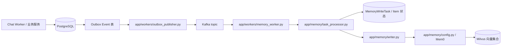

# Agent Chat System：本地开发、模块调用关系与测试手册

> 适用对象：刚接手项目、需要理解架构并进行二次开发的工程师。  
> 当前开发环境：Windows + PowerShell + Conda `learnLLM` + Docker Desktop + Vite/React。  
> 当前部署状态：Dockerfile、Nginx 和 Compose 配置已编写并通过部分静态配置检查；尚未完成全量镜像构建及端到端容器验收。本文中的 Docker 部署部分是操作说明，不代表已在生产环境验证通过。

---

## 目录

1. [项目定位与服务划分](#1-项目定位与服务划分)
2. [第一次启动：本地开发](#2-第一次启动本地开发)
3. [单独启动每个进程与查看日志](#3-单独启动每个进程与查看日志)
4. [端口和环境变量](#4-端口和环境变量)
5. [核心调用关系](#5-核心调用关系)
6. [主要文件用途与依赖方向](#6-主要文件用途与依赖方向)
7. [数据库迁移与维护脚本](#7-数据库迁移与维护脚本)
8. [全部测试脚本：运行方式与前置条件](#8-全部测试脚本运行方式与前置条件)
9. [测试推荐顺序与故障定位](#9-测试推荐顺序与故障定位)
10. [Docker 部署准备与真实部署步骤](#10-docker-部署准备与真实部署步骤)
11. [接手项目后的二次开发流程](#11-接手项目后的二次开发流程)
12. [已知风险与待验收项](#12-已知风险与待验收项)

---

## 1. 项目定位与服务划分

该项目是一个具备异步任务处理、流式聊天响应、长期记忆和代码沙箱能力的 AI 聊天系统。其关键设计是把“接收 HTTP 请求”“后台执行模型任务”“保存业务数据”“向浏览器推送事件”分开。

### 1.1 本地开发时需要的进程

| 进程 | 本地启动入口 | 主要职责 | 典型输出位置 |
|---|---|---|---|
| Backend API | `uvicorn app.main:app` | 接收浏览器 HTTP 请求、提供聊天 API 与 SSE 事件流 | Backend API 窗口 |
| Chat Worker | `python -m app.workers.chat_worker` | 消费聊天运行请求、调用聊天服务与 LangGraph、管理运行状态及重试 | Chat Worker 窗口 |
| Memory Worker | `python -m app.workers.memory_worker` | 消费记忆任务事件，处理持久化记忆任务 | Memory Worker 窗口 |
| Outbox Publisher | `python -m app.workers.outbox_publisher` | 从 PostgreSQL Outbox 读取待发布事件并发布到 Kafka | Outbox Publisher 窗口 |
| Local LLM Server | `uvicorn app.llm.local_llm_server:app` | 加载并提供本地 Qwen 模型 API | Local LLM 窗口 |
| Sandbox API | `uvicorn app.sandbox.main:app` | 接收受限 Python 执行请求，由 Docker Runner 创建临时执行容器 | Sandbox 窗口 |
| Frontend | `npm run dev` | React 页面、Zustand 状态管理、HTTP 请求和 SSE 订阅 | Frontend 窗口 |

另外六个基础设施容器由 Docker 提供：PostgreSQL、Redis、Kafka、etcd、MinIO、Milvus。它们不是上述七个开发进程的一部分。

### 1.2 当前推荐的开发模式

- **日常写代码和调试：** Python 服务运行在 Windows/Conda，前端运行在 Vite；PostgreSQL、Redis、Kafka、Milvus 等由 Docker 提供。
- **查看日志、断点调试：** 单独启动某个 Python 进程，或使用 `scripts/dev.ps1` 打开独立 PowerShell 窗口。
- **Docker 部署准备：** `compose.yaml`、`backend/Dockerfile`、`frontend/Dockerfile`、`frontend/nginx.conf` 描述未来容器部署方式。不要把配置文件语法通过误认为应用镜像已经通过运行验收。

---

## 2. 第一次启动：本地开发

以下命令均在 Windows PowerShell 中执行。项目根目录为：

```powershell
D:\Workspace\pycharm-work\agent-chat
```

### 2.1 前置条件

1. Docker Desktop 正常运行。
2. Conda 环境 `learnLLM` 已创建并安装了项目开发依赖。
3. Node.js 与 npm 可用。
4. 项目根目录存在 `.env`；不要把含真实密码的 `.env` 分享或提交。
5. `frontend/package-lock.json` 存在，以便使用 `npm ci` 时严格依据锁文件安装依赖。

### 2.2 启动基础设施

在项目根目录运行：

```powershell
cd D:\Workspace\pycharm-work\agent-chat
conda activate learnLLM
.\scripts\infra-up.ps1
```

该脚本基于根目录 `compose.yaml` 启动基础设施服务。它应只操作以下六个服务：

- `postgres`
- `redis`
- `kafka`
- `etcd`
- `minio`
- `milvus`

确认容器状态：

```powershell
docker compose --env-file .\.env -f .\compose.yaml ps
```

也可使用：

```powershell
docker ps --format "table {{.Names}}\t{{.Status}}\t{{.Ports}}"
```

PostgreSQL、Redis、etcd、MinIO 应能显示健康状态；Kafka 和 Milvus 至少应处于运行状态。Kafka 与 Milvus 的最终健康检查仍应在真实构建/部署时做运行验证。

### 2.3 启动全部七个本地开发进程

```powershell
.\scripts\dev.ps1
```

`dev.ps1` 会为以下进程分别打开 PowerShell 窗口，并将这些窗口的 PID 记录到根目录 `.dev-pids.txt`：

1. Backend API
2. Sandbox API
3. Local LLM Server
4. Chat Worker
5. Memory Worker
6. Outbox Publisher
7. Frontend

等价的主要访问地址：

| 服务 | 本地地址 |
|---|---|
| Frontend | `http://127.0.0.1:5173/` |
| Backend API | `http://127.0.0.1:8000/` |
| Sandbox API | `http://127.0.0.1:8010/` |
| Local LLM Server | `http://127.0.0.1:8020/` |

如果后端启用了 FastAPI OpenAPI 文档，通常可访问 `http://127.0.0.1:8000/docs`。若应用关闭了 docs，则以 `app/main.py` 的 FastAPI 初始化配置为准。

### 2.4 停止本地开发进程

```powershell
.\scripts\stop-dev.ps1
```

该脚本根据 `.dev-pids.txt` 停止由开发启动脚本记录的 PowerShell 进程树，并移除 PID 文件。它不应停止 Docker 基础设施容器。

**注意：** 不建议只手动关掉部分窗口却长期保留 PID 文件。如果手动关闭了窗口，重新启动 `dev.ps1` 会重新写入 PID 文件；若停止脚本提示进程异常，应先检查当前进程，不要手动终止不相关的 Python 进程。

### 2.5 停止基础设施

```powershell
.\scripts\infra-down.ps1
```

当前脚本通过 `stop` 和 `rm` 处理六个基础设施容器，不使用 `down -v`，也不主动删除 `D:\docker\data\agent-chat\` 下的 bind-mounted 数据。停止后，数据库、Redis、Kafka、Milvus 的数据目录仍然保留。

---

## 3. 单独启动每个进程与查看日志

排查问题时，推荐先停止对应的 `dev.ps1` 进程，然后在**独立 PowerShell 窗口**中单独启动所需服务。这样输出直接显示在当前窗口，容易定位异常与断点调试。

### 3.1 Backend API

```powershell
cd D:\Workspace\pycharm-work\agent-chat\backend
conda activate learnLLM
$env:PYTHONPATH = (Get-Location).Path
python -m uvicorn app.main:app --reload --port 8000 --access-log --log-level info
```

观察：Uvicorn 启动信息、HTTP 请求状态码、API 异常堆栈。`--reload` 适用于开发，不建议在生产容器里使用。

### 3.2 Chat Worker

```powershell
cd D:\Workspace\pycharm-work\agent-chat\backend
conda activate learnLLM
$env:PYTHONPATH = (Get-Location).Path
python -m app.workers.chat_worker
```

观察：PostgreSQL/LangGraph Checkpoint 初始化、Kafka 消费组加入、消息处理、运行重试与终止日志。

### 3.3 Memory Worker

```powershell
cd D:\Workspace\pycharm-work\agent-chat\backend
conda activate learnLLM
$env:PYTHONPATH = (Get-Location).Path
python -m app.workers.memory_worker
```

观察：订阅主题 `memory.extract.requested`、加入 `memory-workers` 消费组、任务处理和 offset 提交情况。模块导入链可能触发模型加载，启动耗时与内存占用应在后续优化时关注。

### 3.4 Outbox Publisher

```powershell
cd D:\Workspace\pycharm-work\agent-chat\backend
conda activate learnLLM
$env:PYTHONPATH = (Get-Location).Path
python -m app.workers.outbox_publisher
```

观察：Kafka Producer 初始化、Outbox 轮询、发布成功/失败记录。

### 3.5 Local LLM Server

```powershell
cd D:\Workspace\pycharm-work\agent-chat\backend
conda activate learnLLM
$env:PYTHONPATH = (Get-Location).Path
python -m uvicorn app.llm.local_llm_server:app --host 127.0.0.1 --port 8020
```

观察：`LOADING LOCAL MODEL`、`LOCAL MODEL READY` 和 Uvicorn 启动日志。模型下载或加载失败时，先排查模型缓存、网络、PyTorch 与硬件资源。

### 3.6 Sandbox API

```powershell
cd D:\Workspace\pycharm-work\agent-chat\backend
conda activate learnLLM
$env:PYTHONPATH = (Get-Location).Path
python -m uvicorn app.sandbox.main:app --host 127.0.0.1 --port 8010
```

观察：`SANDBOX DOCKER READY`、执行请求、超时、容器清理警告。Sandbox Runner 需要能够访问 Docker Daemon。

### 3.7 Frontend

先启动 Backend API。另开一个 PowerShell 窗口：

```powershell
cd D:\Workspace\pycharm-work\agent-chat\frontend
npm run dev -- --host 127.0.0.1
```

若尚未安装前端依赖，首次执行 `npm ci`。不要每次启动都重新安装。

访问 `http://127.0.0.1:5173/`。Vite 代理把 `/api/...` 转发到本机 `127.0.0.1:8000`，HTTP API 与 SSE 都通过该代理。浏览器开发者工具的 Network 页面可以检查 POST、SSE 连接状态和响应事件。

### 3.8 查看日志时的基本原则

- 一个服务一个终端；不要将多个长驻进程放在同一个阻塞窗口中。
- 先看最早出现的异常，不要只看最后一条级联错误。
- `KafkaConnectionError` 先确认 Kafka 容器和 `localhost:9092` 端口。
- PostgreSQL 连接池错误先确认容器健康状态、数据库 URL 和账号密码。
- 浏览器 SSE 报错时，检查 Network 中 `/api/chat/{run_id}/events` 是否持续连接，以及后端 Redis Stream 是否产生事件。
- 若服务提示端口占用，先查占用进程，不要直接结束所有 Python 进程。

---

## 4. 端口和环境变量

### 4.1 当前本地开发常用端口

| 端口 | 服务 | 说明 |
|---:|---|---|
| 5173 | Vite | 本地前端开发服务器 |
| 8000 | Backend API | REST API、SSE 事件流 |
| 8010 | Sandbox API | 请求受限 Python 执行 |
| 8020 | Local LLM Server | 本地 Qwen 模型接口 |
| 5432 | PostgreSQL | 业务数据、Outbox、LangGraph Checkpoint |
| 6379 | Redis | Run Event Stream、幂等租约等运行状态 |
| 9092 | Kafka 外部监听 | Windows 本地开发进程连接 Kafka |
| 29092 | Kafka 内部监听 | Docker 网络中的应用连接 Kafka |
| 19530 | Milvus | 向量检索/记忆存储 |
| 9091 | Milvus HTTP 健康端口 | Milvus 状态检查 |
| 9000 / 9001 | MinIO | 对象存储 API / 控制台 |

### 4.2 `.env` 与 `.env.example`

- `.env` 是本机实际配置，可能包含密码，不应发送到公开位置。
- `.env.example` 是可分享的配置模板，只放占位值或非敏感默认值。
- 当前本地常见变量包括 `DATABASE_URL`、`LANGGRAPH_CHECKPOINT_DATABASE_URL`、`ALEMBIC_DATABASE_URL`、`REDIS_HOST`、`REDIS_PORT`、`KAFKA_BOOTSTRAP_SERVERS`、`MEMORY_LLM_BASE_URL`、`MILVUS_URI`、`SANDBOX_API_URL`、`MEMORY_SEARCH_TIMEOUT_SECONDS` 和 `SANDBOX_HTTP_TIMEOUT_SECONDS`。
- 本地地址使用 `localhost` 或 `127.0.0.1`；容器内部地址由 Compose 覆盖为 `postgres`、`redis`、`kafka:29092`、`milvus`、`local-llm-server`、`sandbox` 等服务名。
- 本地 `SANDBOX_HTTP_TIMEOUT_SECONDS` 建议为 `20`，`MEMORY_SEARCH_TIMEOUT_SECONDS` 建议为 `60`。前者单位是秒，后者由 `backend/app/memory/retriever.py` 读取。

### 4.3 Docker 的 `localhost` 与本地开发不同

在 Windows 本机启动的进程访问 `localhost:5432`，指向宿主机映射端口；而容器里的 `localhost:5432` 指向容器自身。Compose 内必须使用服务名，例如：

```text
postgresql+asyncpg://...@postgres:5432/agent_chat
redis:6379
kafka:29092
http://milvus:19530
http://local-llm-server:8020/v1
http://sandbox:8010
```

请勿把容器内部服务名写进本地 `.env` 的默认值，否则 Windows 本地启动的进程可能无法连接。

---

## 5. 核心调用关系

### 5.1 从浏览器到后端：聊天请求和 SSE

```mermaid
flowchart TD
    UI[ChatPage.tsx] --> STORE[chatStore.ts / Zustand]
    STORE --> API[chatApi.ts + httpClient.ts]
    API --> POST[POST /api/chat]
    POST --> ROUTER[app/api/chat.py]
    ROUTER --> ACCEPT[创建/登记运行请求]
    ACCEPT --> KAFKA[Kafka: chat.run.requested]
    KAFKA --> CW[app/workers/chat_worker.py]
    CW --> CS[app/services/chat_service.py]
    CS --> GRAPH[app/agents/chat/graph.py]
    GRAPH --> NODES[app/agents/chat/nodes.py]
    NODES --> STATE[state.py + context.py]
    CS --> BUS[RunEventBus / Redis Stream]
    STORE --> SSE[chatStream.ts / EventSource]
    SSE --> GET[GET /api/chat/{run_id}/events]
    GET --> ROUTER
    ROUTER --> BUS
    BUS --> SSE
    SSE --> STORE
    STORE --> UI
```

关键点：

1. HTTP POST 是提交工作请求的入口，返回运行标识/状态；它不是直接返回完整模型答案的接口。
2. 浏览器在拿到 `run_id` 后，使用 `EventSource` 单独订阅 `/api/chat/{run_id}/events`。
3. 后端 Worker 在后台执行任务，运行事件写入 Redis Stream；SSE 路由读取事件并推给浏览器。
4. 前端 `chatStore.ts` 接收 thinking、token、completed、error 等回调，更新状态，`ChatPage.tsx` 根据状态渲染界面。
5. Redis Stream 的事件 ID 和 Last-Event-ID 是恢复/续读的重要部分；修改 Stream 字段或事件名时，前后端必须同步修改。

> 图示描述逻辑链路。若某个路由当前实现了额外的 Outbox/数据库步骤，请以 `backend/app/api/chat.py` 和 `backend/app/services/chat_service.py` 的最新代码为准。

### 5.2 Outbox 到 Memory Worker 的持久化事件链路



这个设计将业务事务与异步消息投递分开：Outbox 记录先持久化，再由 Publisher 发布，减少数据库写入与 Kafka 发送之间的丢失窗口。Worker 使用消费组与 offset 管理消息进度，并需要借助任务状态、幂等机制处理重复投递。

### 5.3 Chat Worker 与 LangGraph

```text
Kafka chat.run.requested
    -> chat_worker.py 消费消息
    -> idempotency_service.py 获取/续租/完成运行租约
    -> infrastructure/langgraph/runtime.py 启动 Checkpoint runtime
    -> services/chat_service.py 编排一次聊天运行
    -> agents/chat/graph.py 执行 LangGraph
        -> agents/chat/nodes.py 各节点逻辑
        -> agents/chat/state.py 定义图状态字段
        -> agents/chat/context.py 提供运行上下文
    -> PostgreSQL 保存业务记录/Checkpoint/Outbox
    -> RunEventBus 写 Redis Stream
    -> API SSE 把事件流发回浏览器
```

### 5.4 记忆读写链路

```text
Memory Worker
    -> memory/task_processor.py
    -> memory/extractor.py  / memory/safety.py
    -> memory/writer.py
    -> memory/config.py: call_memory(...)
    -> Mem0 Memory
    -> HuggingFace Embedder
    -> Milvus collection: agent_chat_memories

聊天查询
    -> memory/retriever.py
    -> mem0_search(...)
    -> 按 user/filter/topic 等条件筛选并整理 context
    -> 交给 Chat/Graph 节点使用
```

`memory/config.py` 采用延迟初始化 Mem0，并在连接异常时对只读操作做有限重试和重建向量存储客户端。写操作不应被盲目重放，因为重复写入可能造成重复记录；写入失败应交给 MemoryWriteTask 的失败/恢复机制。

### 5.5 Sandbox 执行链路

```text
业务代码调用 app/sandbox/client.py
    -> POST 到 Sandbox API
    -> app/sandbox/main.py 校验请求/响应模型
    -> app/sandbox/docker_runner.py
    -> Docker SDK 创建一次性执行容器
       - python -I -c <code>
       - network_disabled=True
       - read_only=True
       - 设置非 root user、memory/CPU/PID 限制
       - 移除 capabilities、no-new-privileges
    -> 收集 stdout/stderr/exit code/duration
    -> 强制清理执行容器
```

Sandbox 的 Docker Socket 属于高权限边界。生产环境应优先为其分配隔离的 Docker Daemon/执行节点；不能把宿主机 Docker Socket 默认暴露给普通业务 API 或 Worker。

---

## 6. 主要文件用途与依赖方向

### 6.1 根目录与部署文件

| 文件 | 用途 | 依赖/关联 |
|---|---|---|
| `compose.yaml` | 描述 Redis、Kafka、PostgreSQL、Milvus 依赖及未来应用容器 | `.env`、各 Dockerfile、`infra/redis/redis.conf` |
| `.env` | 本机真实配置、密码、端口、连接 URL | PowerShell scripts、Compose、各 Python `load_dotenv` / `os.getenv` |
| `.env.example` | 可共享的配置模板 | 与 `.env` 保持变量名同步；不得存放真实密码 |
| `.gitignore` | Git 忽略规则模板 | 当前项目尚未初始化 Git；规则本身不影响运行 |
| `README.md` | 项目入口说明 | 指向开发者手册/部署步骤 |
| `backend/Dockerfile` | 后端 API、Worker、LLM、Sandbox 共用的候选镜像构建文件 | `backend/requirements.txt`、`app/`、`alembic/` |
| `backend/.dockerignore` | 排除后端镜像不需要的文件 | `backend/Dockerfile` |
| `frontend/Dockerfile` | Node 构建阶段 + Nginx 静态运行阶段 | `package.json`、`package-lock.json`、`frontend/nginx.conf` |
| `frontend/nginx.conf` | 静态文件、SPA 路由、`/api/` 转发、SSE 禁缓冲 | Compose 中的 `backend:8000` |
| `frontend/.dockerignore` | 排除 `node_modules`、`dist`、本地环境文件 | `frontend/Dockerfile` |
| `infra/redis/redis.conf` | Redis 服务器配置，Compose 以只读方式挂载 | 根目录 `compose.yaml`；不能删除 |

### 6.2 前端 `frontend/src/`

| 文件 | 责任 | 调用关系 |
|---|---|---|
| `main.tsx` | React 应用入口 | 挂载 `App.tsx` |
| `App.tsx` | 应用根组件/页面组装 | 使用 `ChatPage.tsx` 等页面 |
| `pages/ChatPage.tsx` | 聊天界面、输入与消息显示 | 调用 `chatStore.ts`，渲染状态 |
| `stores/chatStore.ts` | Zustand 聊天状态、发送动作、运行状态 | 调用 `chatApi.ts` 和 `chatStream.ts` |
| `api/httpClient.ts` | Axios 基础配置，当前 `baseURL: "/api"` | Vite 开发代理或生产 Nginx 代理 |
| `api/chatApi.ts` | 创建聊天运行等 HTTP API 封装 | 使用 `httpClient.ts`，调用后端 `/api/chat` |
| `services/chatStream.ts` | 使用 EventSource 订阅 SSE、分发事件、关闭连接 | 访问 `/api/chat/{run_id}/events`，回调更新 Store |
| `types/chat.ts` | 前端消息、运行状态、请求/响应的 TypeScript 类型 | API、Store、Page 共用 |
| `vite.config.ts` | 本地开发服务器；`/api` 转发到 `127.0.0.1:8000` | `npm run dev` |
| `package.json` | npm 脚本和前端依赖 | `npm ci`、`npm run dev`、`npm run build`、`npm run lint` |
| `package-lock.json` | 锁定 Node 依赖解析版本 | `npm ci` 与 Docker 前端构建 |
| `eslint.config.js` | ESLint 规则 | `npm run lint` |
| `tsconfig*.json` | TypeScript 编译配置 | `npm run build` 中的 `tsc -b` |
| `index.html` | Vite HTML 模板 | Vite build 入口 |

### 6.3 后端入口/API/Schema

| 文件 | 责任 | 调用关系 |
|---|---|---|
| `backend/app/main.py` | 初始化 FastAPI、注册路由和生命周期/中间件 | 导入 `api/chat.py` 等模块 |
| `backend/app/api/chat.py` | HTTP 聊天入口和 SSE 事件流路由 | 调用服务、运行管理和事件总线等组件 |
| `backend/app/schemas/chat.py` | Pydantic 请求/响应结构 | API、服务之间的数据契约 |
| `backend/app/services/run_manager.py` | 运行 ID/运行状态相关管理 | API 与运行生命周期协作；修改前检查具体调用方 |
| `backend/app/services/chat_service.py` | 聊天业务编排、调用 LangGraph/事件发布等 | Chat Worker、Graph、RunEventBus、Repositories |
| `backend/app/services/idempotency_service.py` | 获取/续租/完成运行租约，防止重复处理并检测 lease 丢失 | Chat Worker、Redis |

### 6.4 Agent 与 LangGraph

| 文件 | 责任 | 二次开发时关注 |
|---|---|---|
| `agents/chat/state.py` | LangGraph 状态字段定义 | 增加状态字段时检查节点输入输出与持久化兼容性 |
| `agents/chat/context.py` | 图执行上下文/依赖信息 | 运行时依赖与上下文传递 |
| `agents/chat/nodes.py` | 具体图节点逻辑 | 增加/修改模型调用、工具调用、记忆检索等业务逻辑 |
| `agents/chat/graph.py` | 定义节点、边和图构建方式 | 新节点必须注册到图中，并明确终止/分支条件 |
| `infrastructure/langgraph/runtime.py` | 创建 PostgreSQL Connection Pool、Checkpoint Saver 和编译后的 Graph | `start_langgraph_runtime`/`stop_langgraph_runtime`；依赖 `LANGGRAPH_CHECKPOINT_DATABASE_URL` |

### 6.5 基础设施适配层

| 文件 | 责任 | 使用方 |
|---|---|---|
| `infrastructure/database/base.py` | SQLAlchemy Declarative Base | Models、Alembic |
| `infrastructure/database/engine.py` | 从 `DATABASE_URL` 建立异步 SQLAlchemy Engine | Session 层 |
| `infrastructure/database/session.py` | AsyncSessionLocal、DB session 依赖 | API、Worker、Repositories |
| `infrastructure/kafka/topics.py` | Kafka topic 名称常量 | Producer、Workers、Outbox Publisher |
| `infrastructure/kafka/producer.py` | 初始化/发送 Kafka 消息 | API/业务/Publisher 中需要发布消息的路径 |
| `infrastructure/redis/client.py` | Redis Async Client；`REDIS_HOST`/`REDIS_PORT` 可配置 | RunEventBus、幂等租约等 |
| `infrastructure/redis/run_event_bus.py` | Redis Stream 事件写入与读取 | Chat Service/Worker 写事件、SSE 路由读事件 |

### 6.6 Worker

| 文件 | 责任 | 主要依赖 |
|---|---|---|
| `workers/chat_worker.py` | 消费聊天运行请求，处理运行状态、租约/心跳、异常和 Kafka offset | aiokafka、Chat Service、IdempotencyService、DB、Redis、LangGraph Runtime |
| `workers/memory_worker.py` | 消费 `memory.extract.requested` 并协调记忆任务处理 | aiokafka、SQLAlchemy、Memory task processor |
| `workers/outbox_publisher.py` | 从数据库 Outbox 读取未发布事件并投递 Kafka | Outbox Repository、Kafka Producer/aiokafka、PostgreSQL |

### 6.7 Models 与 Repositories

`models/` 定义数据库映射，`repositories/` 封装常用的数据访问。服务和 Worker 应尽量经由 Repository 进行业务数据读写，而不是把散落的 SQL 放到 API 路由中。

| 文件/目录 | 责任 |
|---|---|
| `models/conversation.py` | Conversation ORM 模型 |
| `models/message.py` | Message ORM 模型 |
| `models/chat_run.py` | ChatRun 运行状态模型 |
| `models/outbox_event.py` | Outbox 事件模型 |
| `models/memory_write_task.py` | 记忆写入任务模型 |
| `models/memory_write_item.py` | 记忆写入项模型 |
| `repositories/conversation_repository.py` | Conversation 数据访问 |
| `repositories/message_repository.py` | Message 数据访问 |
| `repositories/chat_run_repository.py` | ChatRun 数据访问 |
| `repositories/outbox_repository.py` | Outbox 查询/标记发布等 |
| `repositories/memory_write_task_repository.py` | MemoryWriteTask 数据访问 |

新增数据库字段时通常涉及 **Model + Alembic migration + Repository + 调用方 + 测试**，不能只改 ORM 文件就结束。

### 6.8 Memory

| 文件 | 责任 |
|---|---|
| `memory/config.py` | Mem0 配置、Embedding 模型、Milvus 地址、惰性初始化、统一调用及读操作连接恢复 |
| `memory/extractor.py` | 从输入文本提取候选长期记忆 |
| `memory/safety.py` | 检查/过滤敏感数据 |
| `memory/keys.py` | 生成/规范化记忆键 |
| `memory/retriever.py` | 根据查询检索相关记忆、控制检索超时并准备上下文 |
| `memory/writer.py` | 把记忆项写入长期记忆存储 |
| `memory/task_processor.py` | 处理 MemoryWriteTask/Item 的业务状态与写入流程 |
| `memory/retry_task.py` | 记忆任务重试/恢复辅助逻辑；具体调用点以源码为准 |

### 6.9 Sandbox 与 LLM

| 文件 | 责任 |
|---|---|
| `llm/local_llm.py` | 本地模型加载/推理封装；会影响模型内存占用 |
| `llm/local_llm_server.py` | 作为独立 HTTP 服务提供本地模型接口 |
| `sandbox/client.py` | 业务侧 Sandbox HTTP 客户端，地址由 `SANDBOX_API_URL` 配置 |
| `sandbox/main.py` | Sandbox API 服务入口与接口处理 |
| `sandbox/schemas.py` | Sandbox 请求/响应模型 |
| `sandbox/policies.py` | Sandbox 镜像、资源限制、超时和输出上限策略 |
| `sandbox/docker_runner.py` | 使用 Docker SDK 创建、运行、收集输出并清理执行容器 |

### 6.10 数据库迁移

- `backend/alembic.ini`：Alembic 配置入口。
- `backend/alembic/env.py`：迁移运行环境、数据库 URL 与 Model metadata 配置。
- `backend/alembic/versions/*.py`：按版本记录表结构变更。
- `backend/requirements-stage7-verified.txt`：Stage 7 已验证环境快照，不应直接视为适用于 Linux 的最终锁定依赖。
- `backend/requirements.txt`：应用直接依赖列表；实际部署前仍需验证 Python 版本、Linux wheel、Torch CPU/GPU 选择与间接依赖兼容性。

### 6.11 根目录 `scripts/` 与 `backend/scripts/`

| 文件 | 用途 |
|---|---|
| `scripts/dev.ps1` | 本地打开七个服务窗口，记录 PID |
| `scripts/stop-dev.ps1` | 停止由 `dev.ps1` 记录的进程树 |
| `scripts/infra-up.ps1` | 启动六个基础设施 Compose 服务 |
| `scripts/infra-down.ps1` | 停止并移除六个基础设施容器，不主动删除宿主机 bind 数据 |
| `scripts/check-requirements.ps1` | 比较 `requirements.txt` 的 pinned direct dependencies 与 Stage 7 快照 |
| `backend/scripts/cleanup_test_memories.py` | 清理测试记忆；运行前务必阅读代码确认筛选范围，避免误清理真实数据 |
| `backend/scripts/inspect_checkpoint.py` | 检查 LangGraph Checkpoint 数据 |
| `backend/scripts/search_milvus_data.py` | 检查/查询 Milvus 数据 |

---

## 7. 数据库迁移与维护脚本

### 7.1 查看迁移状态

在 `backend` 目录、激活 `learnLLM` 并设置 `PYTHONPATH` 后执行：

```powershell
python -m alembic current
python -m alembic history
```

### 7.2 应用迁移

**仅在确认目标数据库正确且有备份后执行**：

```powershell
python -m alembic upgrade head
```

数据库结构变更的建议顺序：

1. 修改 SQLAlchemy Model。
2. 生成或编写 Alembic migration。
3. 检查 migration 的 upgrade/downgrade 内容。
4. 在独立开发数据库上执行迁移。
5. 更新 Repository 与业务调用方。
6. 增加/更新测试。

### 7.3 维护脚本注意事项

`cleanup_test_memories.py` 可能删除数据；运行前先读其 user_id、filter 和删除逻辑，只针对明确的测试数据操作。`inspect_checkpoint.py` 与 `search_milvus_data.py` 通常用于诊断，不应把输出中的敏感数据直接复制到公开日志。

---

## 8. 全部测试脚本：运行方式与前置条件

### 8.1 统一运行前准备

测试脚本 `test_retrieval_relevance.py` 已验证需要在 `backend` 目录下运行，并显式把该目录加入 `PYTHONPATH`，否则可能出现：

```text
ModuleNotFoundError: No module named 'app'
```

每次打开用于测试的新 PowerShell 窗口，执行：

```powershell
cd D:\Workspace\pycharm-work\agent-chat\backend
conda activate learnLLM
$env:PYTHONPATH = (Get-Location).Path
```

需要真实基础设施的测试前，先在另一个窗口、项目根目录运行：

```powershell
.\scripts\infra-up.ps1
```

一些集成测试会写入 PostgreSQL、Redis、Kafka 或 Milvus。请使用开发数据，运行前看清测试代码是否会清理 Stream、任务或记忆。不要对生产数据运行测试脚本。

> 目前目录清单中 `backend/tests/e2e/` 目录为空，没有列出 E2E 测试脚本。以下覆盖当前目录中列出的 13 个测试文件。测试说明根据文件名、项目职责和已观察到的日志整理；每个脚本具体使用 mock 还是真实基础设施，以该测试文件本身的 fixture/初始化逻辑为准。

### 8.2 Unit tests

以下命令都在 `backend` 目录执行。逐条运行比一次性运行所有测试更容易定位失败来源。

#### 1. `tests/unit/test_extractor.py`

```powershell
python .\tests\unit\test_extractor.py
```

用途：检查 `app.memory.extractor` 的候选记忆提取逻辑。已有开发验证案例包含：普通问候不产生长期记忆、明确偏好应提取、单纯提问不应被误认为用户偏好。若脚本调用模型或外部服务，确保所需配置可用。

#### 2. `tests/unit/test_review_parser.py`

```powershell
python .\tests\unit\test_review_parser.py
```

用途：检查 Review/解析器相关输入到结构化结果的解析行为。新增格式、边界输入或解析规则时应同步补充用例；精确断言以文件内部测试数据为准。

#### 3. `tests/unit/test_run_event_bus.py`

```powershell
python .\tests\unit\test_run_event_bus.py
```

用途：检查 `RunEventBus` 的事件写入/读取及事件字段行为。若测试连接实际 Redis，先启动 Redis；若用 mock，则不需要真实 Redis。修改 Stream key、事件 ID、`type/data` 或序列号时优先运行此测试。

#### 4. `tests/unit/test_safety.py`

```powershell
python .\tests\unit\test_safety.py
```

用途：检查记忆/输入安全过滤，包括 `contains_sensitive_data` 一类逻辑。修改敏感信息识别规则时应运行，并同时考虑误报和漏报。

### 8.3 Integration tests

#### 5. `tests/integration/test_langgraph.py`

```powershell
python .\tests\integration\test_langgraph.py
```

用途：验证 LangGraph 图构建、运行时或 Checkpoint 集成。通常需要 PostgreSQL 及有效的 `LANGGRAPH_CHECKPOINT_DATABASE_URL`；如果测试执行真实节点，还可能需要 Local LLM/其他服务。

#### 6. `tests/integration/test_memory.py`

```powershell
python .\tests\integration\test_memory.py
```

用途：检查 Mem0 记忆读写集成。根据测试内容可能依赖 Milvus、Embedding 模型、Local LLM API 和相关 `.env` 配置。运行后检查是否留下测试记忆。

#### 7. `tests/integration/test_publish_stream.py`

```powershell
python .\tests\integration\test_publish_stream.py
```

用途：检查事件发布和 Stream/消息发布链路。根据测试实现可能涉及 Redis Stream、Kafka 或后台 Worker；运行前确认所需基础设施已启动，并查看测试是否创建测试运行 ID。

#### 8. `tests/integration/test_redis.py`

```powershell
python .\tests\integration\test_redis.py
```

用途：验证 Redis 连接与相关 Redis 操作。需要 `REDIS_HOST`/`REDIS_PORT` 与实际开发环境匹配，默认本地端口是 `6379`。

#### 9. `tests/integration/test_retrieval_relevance.py`

```powershell
python .\tests\integration\test_retrieval_relevance.py
```

用途：检查记忆检索的相关性和低价值查询过滤。已实际观察到的通过输出包括：

```text
TEST greeting: PASS
TEST database relevance: PASS
TEST language relevance: PASS
```

该测试曾检索到 PostgreSQL 数据库偏好和 Python/Java 语言偏好。实际运行通常需要可用的 Milvus/记忆数据与 Embedding 模型；测试数据可能依赖固定 user_id。

#### 10. `tests/integration/test_sandbox_client.py`

```powershell
python .\tests\integration\test_sandbox_client.py
```

用途：检查 `SandboxClient` 向 Sandbox API 发送执行请求、解析响应和处理错误的行为。需要 Sandbox API 在 `127.0.0.1:8010` 可用，且 Sandbox Runner 能访问 Docker Daemon。

#### 11. `tests/integration/test_stage5109_validation.py`

```powershell
python .\tests\integration\test_stage5109_validation.py
```

用途：Stage 5.1.09 的阶段性回归/验收脚本。运行前查看脚本头部、固定测试数据、清理代码和所依赖的服务；阶段编号本身不能替代对具体断言的理解。

#### 12. `tests/integration/test_stream_maxlen.py`

```powershell
python .\tests\integration\test_stream_maxlen.py
```

用途：验证 Redis Stream 的长度上限，尤其是 `XADD MAXLEN` 是否能防止 Stream 在大量事件下无限增长。依赖 Redis；如果使用固定 Stream key，运行前确认测试是写入独立测试 key 还是覆盖现有 key。

#### 13. `tests/integration/test_task_processor.py`

```powershell
python .\tests\integration\test_task_processor.py
```

用途：检查记忆任务处理、状态更新、失败/完成处理以及相关持久化路径。通常涉及 PostgreSQL；若测试执行真实 Mem0 写入，还会涉及 Milvus、Embedding 或 Local LLM。先阅读测试内的任务创建与清理逻辑。

### 8.4 推荐逐个运行的顺序

第一次接手时，推荐按由轻到重执行：

```powershell
# 已在 backend 目录，且 PYTHONPATH 已设置
python .\tests\unit\test_safety.py
python .\tests\unit\test_extractor.py
python .\tests\unit\test_review_parser.py
python .\tests\unit\test_run_event_bus.py

python .\tests\integration\test_redis.py
python .\tests\integration\test_stream_maxlen.py
python .\tests\integration\test_publish_stream.py
python .\tests\integration\test_langgraph.py
python .\tests\integration\test_memory.py
python .\tests\integration\test_retrieval_relevance.py
python .\tests\integration\test_task_processor.py
python .\tests\integration\test_sandbox_client.py
python .\tests\integration\test_stage5109_validation.py
```

这不是保证所有测试无副作用的批量脚本。首次运行时请逐条执行，记录通过/失败和日志，再继续下一条。

### 8.5 语法与依赖快速检查

这些检查不替代功能测试：

```powershell
# 从 backend 目录
python -m compileall -q app tests
python -m pip check
```

前端检查从项目根目录执行：

```powershell
cd D:\Workspace\pycharm-work\agent-chat\frontend
npm run lint
npm run build
```

前端 `npm run build` 会执行 TypeScript 项目构建检查和 Vite 生产构建；它会在本机生成 `dist/`，不启动 Docker 容器。

---

## 9. 测试推荐顺序与故障定位

### 9.1 基础设施不可用

先运行：

```powershell
docker ps --format "table {{.Names}}\t{{.Status}}\t{{.Ports}}"
```

然后检查 `.env` 中的端口和 URL。不要在 Compose 网络内部使用 `localhost` 指向其他容器。

### 9.2 `ModuleNotFoundError: No module named 'app'`

在 `backend` 目录运行：

```powershell
$env:PYTHONPATH = (Get-Location).Path
```

再重试该测试。不要为了修一个测试的导入路径随意移动整个 `app/` 目录。

### 9.3 Kafka `Connection refused`

本地 Worker 使用 `localhost:9092`，容器内部 Worker 使用 `kafka:29092`。确认 Worker 的运行环境与变量值匹配，检查 Kafka 容器状态及 broker 日志。

### 9.4 PostgreSQL/Checkpoint 连接失败

确认三类 URL：

- `DATABASE_URL`：SQLAlchemy asyncpg 路径。
- `LANGGRAPH_CHECKPOINT_DATABASE_URL`：LangGraph 的 psycopg async pool 使用。
- `ALEMBIC_DATABASE_URL`：Alembic 的 psycopg 路径。

确认协议、用户名、密码、数据库名和地址都正确。不要在问题诊断输出中公开真实数据库 URL。

### 9.5 记忆检索返回空

依次检查：Milvus 是否可连接、集合是否存在、Embedding 模型是否可加载、测试的 `user_id`/filters 是否匹配、数据是否确实写入。空结果不一定等于检索函数出错，也可能是过滤条件或测试数据不匹配。

### 9.6 SSE 连接建立但不收事件

检查顺序：浏览器 Network → `/api/chat/{run_id}/events` → 后端日志 → Redis Stream 对应 key → Chat Worker 日志。还要确认前端事件名与后端事件名一致、token 字段使用同一命名、终止事件会关闭 EventSource。

---

## 10. Docker 部署准备与真实部署步骤

### 10.1 现有部署文件

- 根目录 `compose.yaml`：六个基础设施服务和候选应用服务配置。
- `backend/Dockerfile`：后端共享镜像，默认 CMD 启动 FastAPI；Worker 通过 Compose 的 `command` 覆盖。
- `backend/.dockerignore`：排除本地环境文件、测试、缓存等。
- `frontend/Dockerfile`：Node 构建阶段、Nginx 运行阶段。
- `frontend/nginx.conf`：静态页面、SPA fallback、`/api/` 代理和 SSE 关闭缓冲。
- `frontend/.dockerignore`：排除 `node_modules`、`dist` 和本地环境文件。

### 10.2 部署前后端代码的连接地址

| 依赖 | Windows 本地进程 | Docker 内应用容器 |
|---|---|---|
| PostgreSQL async | `localhost:5432` | `postgres:5432` |
| PostgreSQL checkpoint/Alembic | `localhost:5432` | `postgres:5432` |
| Redis | `localhost:6379` | `redis:6379` |
| Kafka | `localhost:9092` | `kafka:29092` |
| Milvus | `127.0.0.1:19530` | `milvus:19530` |
| Local LLM | `127.0.0.1:8020` | `local-llm-server:8020` |
| Sandbox API | `127.0.0.1:8010` | `sandbox:8010` |

### 10.3 Linux 服务器上的真实部署流程（计划操作，不代表已执行）

1. 准备 Linux 服务器、Docker Engine/Compose、持久化数据目录及安全组/防火墙策略。
2. 将项目代码和无秘密的部署模板放到服务器；单独创建生产 `.env`，使用强密码，不能复制开发环境的弱口令。
3. 将 `AGENT_CHAT_DATA_DIR` 设置为服务器绝对路径，并确保目录权限与容器用户匹配。
4. 核对 Kafka 内部/外部监听地址、Sandbox Docker Daemon、Milvus/MinIO 凭据、模型文件缓存及 GPU/CPU 资源。
5. 静态检查：`docker compose --env-file .env -f compose.yaml config -q`。
6. 构建镜像：`docker compose --env-file .env -f compose.yaml build`。**当前尚未完成这一真实构建验收。**
7. 先启动基础设施并检查健康状态，再执行数据库 migration，最后启动 API、Workers、LLM、Sandbox 和 Frontend。
8. 检查日志与服务健康状态，执行最小聊天链路、SSE、数据库持久化、Outbox/Kafka、记忆读写和 Sandbox 测试。
9. 配置 HTTPS/反向代理、防火墙、备份、日志轮转、监控、警报与升级/回滚流程。

### 10.4 必须解决的生产事项

- **依赖锁定：** 目前 `requirements.txt` 在 Linux `pip --dry-run` 下能解析，但间接依赖出现版本漂移，且 PyTorch 解析带入大量 CUDA/NVIDIA 依赖。需要选择 CPU/GPU 安装方案，并在目标 Linux 镜像中验证真实安装和功能。
- **多进程模型内存：** 本地日志显示多个 Python 进程导入时都出现过 Qwen 模型加载输出。需要确认是否每个 API/Worker/Sandbox 进程都加载完整模型，避免重复占用内存/显存；优先通过独立 Local LLM Server 统一推理调用。
- **Sandbox 高权限：** `docker_runner.py` 使用 Docker SDK；Sandbox 容器配置挂载 Docker Socket 时，服务可能获得宿主机级别控制权。生产建议使用隔离执行主机或专用 Docker Daemon，不要将 Sandbox 与普通业务进程视作相同信任级别。
- **健康检查：** Compose 静态语法通过不是运行验收。Kafka 的 `kafka-topics.sh` 路径、Milvus `/healthz`、Backend `/openapi.json` 均须在最终镜像中真实验证。
- **生产凭据：** `.env.example` 中占位值只用于模板。生产 MinIO/PostgreSQL/Kafka 及 API 应使用强凭据，并限制公开端口。
- **模型缓存：** 共享模型缓存卷的所有者与权限需要在 Linux 容器中验证，模型下载缓存也要规划持久化空间。
- **应用重启策略：** `depends_on` 是启动顺序辅助，不替代应用自身的连接重试/恢复机制。

---

## 11. 接手项目后的二次开发流程

建议每次按以下闭环开发，而不是一次改动多个层：

1. **确定请求链路：** 从 `ChatPage.tsx`/`chatStore.ts` 开始追前端动作，或从 `api/chat.py` 开始追后端入口。
2. **明确职责层：** API 负责请求边界；Service 编排业务；Repository 负责 DB 存取；Model 定义表映射；Worker 处理异步消息；Infrastructure 适配 Kafka/Redis/PostgreSQL。
3. **追数据契约：** 请求/响应检查 `schemas/chat.py` 与 `frontend/src/types/chat.ts`；事件检查 topic 常量、消息 key/value、Redis Stream 的 event/data/id 字段。
4. **最小修改：** 只改与需求直接相关的层，避免在 API、Worker、Repository 中复制业务逻辑。
5. **加测试：** 纯逻辑先跑 unit；Redis/Kafka/PostgreSQL/Milvus/Sandbox 相关变更再跑相应 integration。
6. **回归：** `python -m compileall -q app tests`、`python -m pip check`；前端变更再跑 `npm run lint` 和 `npm run build`。
7. **观察日志：** 单独启动被修改的进程，核验正常路径与错误路径。
8. **数据库变更：** Model + migration + Repository + 测试一并提交；不在代码里偷偷创建生产表。
9. **文档同步：** 新环境变量同步更新 `.env.example`；新服务同步更新 `compose.yaml`、Docker 配置与 README/本手册。

### 11.1 常见扩展点

- 新增聊天状态字段：`agents/chat/state.py` → 节点输入输出 → 图的边/条件 → 前端类型（若下发）→ 测试。
- 新增 LangGraph 节点：`nodes.py` 实现 → `graph.py` 注册/连边 → 必要时扩展 `context.py` → 增加图运行测试。
- 新增数据库字段：`models/` → Alembic migration → `repositories/` → Service/Worker → 集成测试。
- 增加新的 Kafka 事件：`topics.py` → Producer/Outbox 写入 → Consumer/Worker → key/value/schema → 重试/幂等与 offset 语义测试。
- 修改 Redis Stream 事件：`run_event_bus.py` → SSE 路由 → `chatStream.ts` 事件名/字段 → Store 回调 → `test_run_event_bus.py` 与 Stream 测试。
- 增加长期记忆策略：`extractor.py` / `safety.py` → `task_processor.py`/`writer.py` → `config.py`/Mem0 → `retriever.py` → 单元和集成测试。
- 新增 Sandbox policy：`policies.py` → `docker_runner.py` 参数 → `schemas.py` 校验/响应 → `client.py` → `test_sandbox_client.py`。

---

## 12. 已知风险与待验收项

### 已完成或已有证据

- 本地 `dev.ps1` 已成功启动过七个开发进程，并输出 Vite、Uvicorn、Kafka Worker、Outbox Publisher 和模型加载日志。
- `stop-dev.ps1` 已验证能停止被追踪的开发进程，同时保留基础设施容器。
- `infra-up.ps1` / `infra-down.ps1` 已切换为根目录 `compose.yaml` 的基础设施服务列表并验证过停止/恢复流程。
- 根目录统一 Compose 的 `config -q` 已通过；六个基础设施服务曾在统一 Compose 下启动成功。
- `retriever.py` 中的 `MEMORY_SEARCH_TIMEOUT_SECONDS` 已改为从环境变量读取，默认 `60.0`；测试输出显示问候、数据库偏好、语言偏好相关性三个用例通过。
- Redis client 已支持 `REDIS_HOST`/`REDIS_PORT`；Memory Worker 的 Kafka 地址已支持 `KAFKA_BOOTSTRAP_SERVERS`；Mem0 的 Local LLM/Milvus 地址已支持环境变量。
- 前端 HTTP API/SSE 已改为 `/api` 相对路径；Vite 开发代理与生产 Nginx 配置已编写。

### 尚未完成或不能宣称通过

- 尚未确认所有测试脚本都成功通过；仅已知运行过的测试应按实际日志报告。
- 未完成所有应用镜像的真实构建、启动与 E2E 验收。
- `requirements.txt` 还没有适合目标 Linux CPU/GPU 环境的完整锁定与安装验证。
- Docker Compose 中 Kafka、Milvus、Backend 的健康检查需要在最终镜像内运行验证。
- Sandbox Docker Socket 权限、隔离与生产安全策略仍需设计/验收。
- 模型多进程加载导致的资源开销仍需评估。
- `backend/tests/e2e/` 当前为空；若要做正式 E2E 测试，需要新增可重复、隔离测试数据的完整流程测试。
- 没有 Git 仓库时，`.gitignore` 规则无法使用 `git check-ignore` 正式验证；项目目前并未初始化 Git，这是刻意暂缓，不影响本地运行。

---

## 快速启动备忘

正常本地开发最常用的三条命令：

```powershell
cd D:\Workspace\pycharm-work\agent-chat
conda activate learnLLM
.\scripts\infra-up.ps1
.\scripts\dev.ps1
```

要单独查看某个服务输出：使用第 3 章的对应启动命令，在单独 PowerShell 窗口运行。要停止开发进程：

```powershell
.\scripts\stop-dev.ps1
```

要停止基础设施容器（会影响所有依赖这些服务的本地开发进程）：

```powershell
.\scripts\infra-down.ps1
```

**最后提醒：** 日常二次开发默认使用 Windows + Conda + Docker 基础设施即可；只有在准备部署验收时才需要构建应用镜像。配置文件已经准备不等于生产部署已被证明可靠，生产环境应按第 10、12 章逐项验收。


## 👤 Author

Created and maintained by **UNan**.

- GitHub: [@YU-UR](https://github.com/YU-UR)
- Repository: [agent-chat-developer](https://github.com/YU-UR/agent-chat-developer)

## 📜 License

This project is currently provided for personal and educational use only.


© 2026 UNan. All rights reserved.